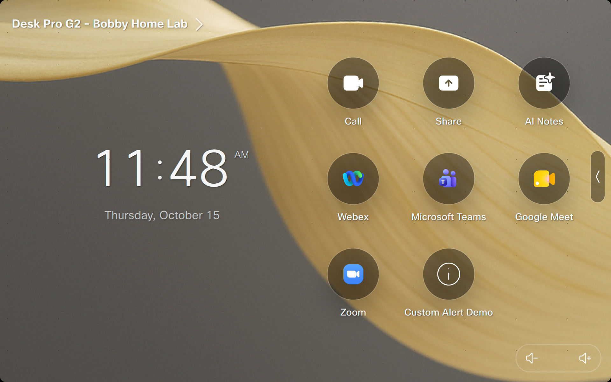
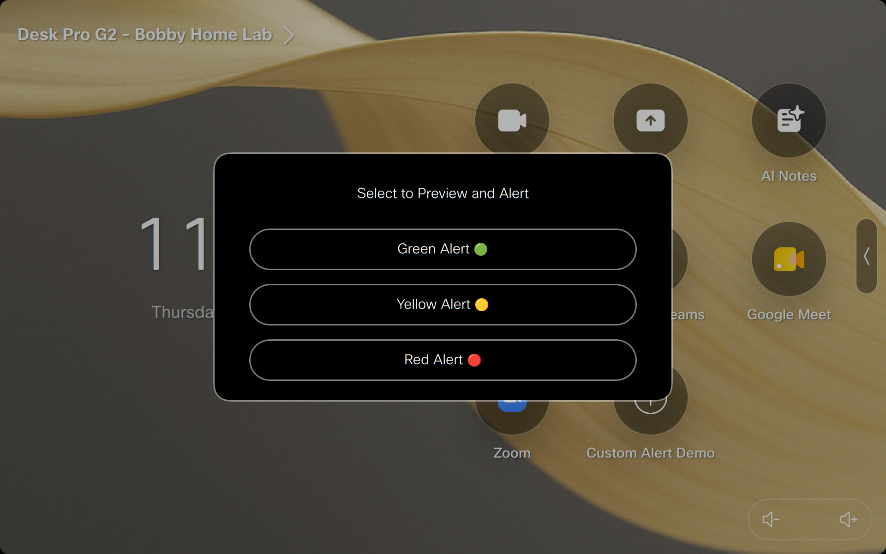
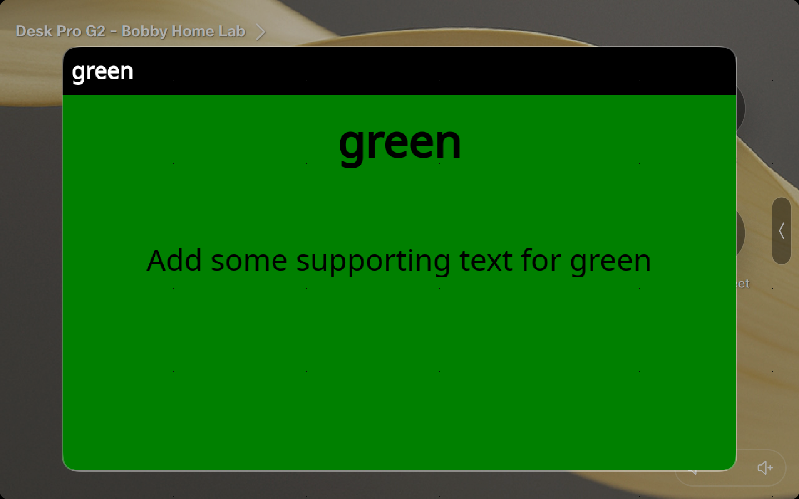
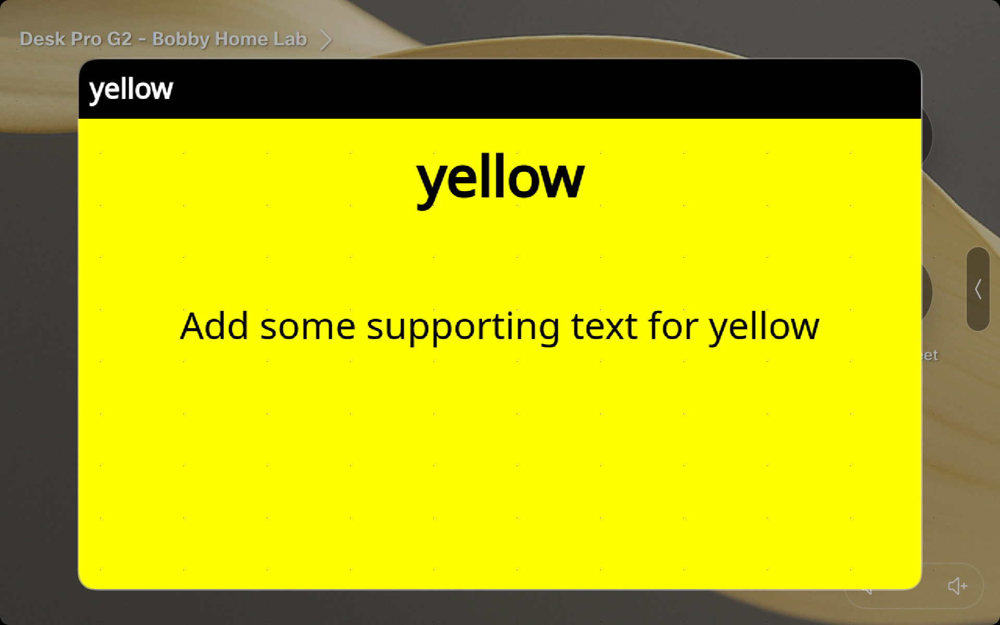
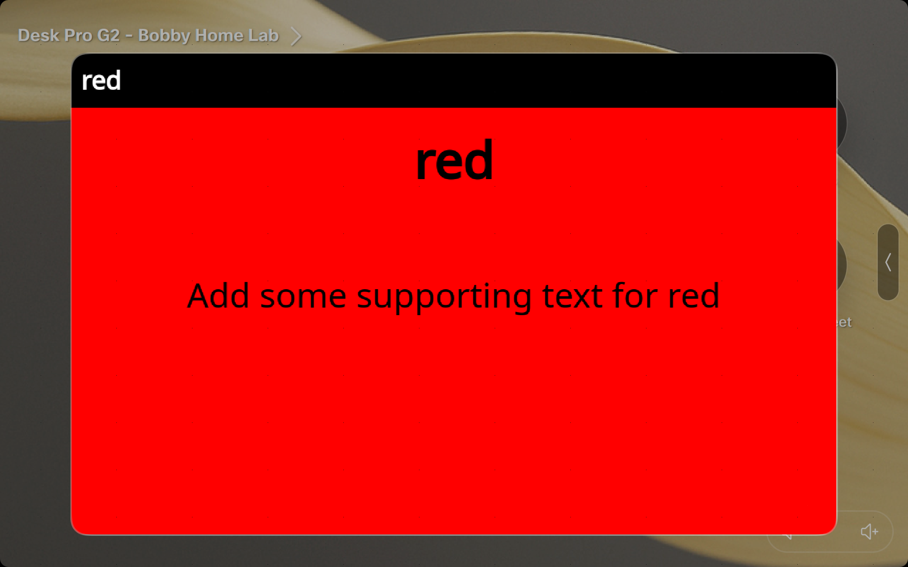

# Simple Custom Alert using Data HTML

This proof of concept demonstrates simple HTML based alert content in the RoomOS Web Engine. It builds a `data:text/html` URL in a macro and displays the page in a modal WebView. The example offers green, yellow, and red alerts with a title and supporting text.

## Requirements

- A Cisco RoomOS device with WebEngine support.
- Macros enabled on the device.

## Try the demo

1. Add `Custom_Alert_Demo.js` as a macro on the RoomOS device and enable it.
2. Add the **Custom Alert Demo** home screen UI extension button, with actions for green, yellow, and red using the widget ID format above.
3. On the device home screen, select **Custom Alert Demo**, then choose an alert color.
4. The macro creates and displays the selected alert as a modal WebView.

## Character limit

The complete generated `data:text/html` URL must be **2,000 characters or fewer**. The macro checks the URL length and throws an error when it exceeds this limit. Since the HTML is URL encoded, content can take more characters in the URL than it does as readable text. Keep the header, title, and supporting text concise.

## UX screenshots

The first two screenshots show the home screen entry point and alert selector. The remaining screenshots show the green, yellow, and red alert results.

### 1. Home screen entry point

### 2. Alert selector

### 3. Green alert result

### 4. Yellow alert result

### 5. Red alert result

